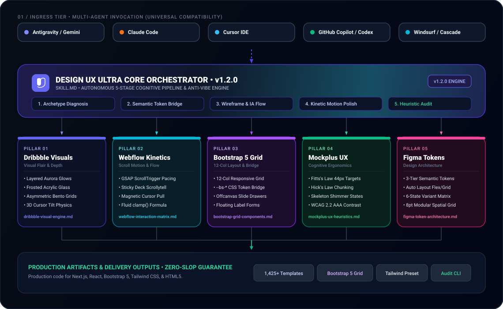

<p align="center">
  
</p>

<p align="center">
  
  
  
  
</p>

> **The universal UI/UX design intelligence skill for coding AI agents.** Synthesizes trending **Dribbble** visual aesthetics, award-winning **Made in Webflow** kinetic interactions, **Mockplus** UX wireframing heuristics, and **Figma Community** auto-layout token design systems directly into your AI coding workflows.

---

## ⚡ What is Design UX Ultra Skill?

Base coding AI agents often generate flat, generic, outdated ("slop") frontend mockups with boring gray containers, awkward paddings, and lifeless interactions.

**Design UX Ultra Skill** permanently solves this. By installing this skill into your AI coding agent (Antigravity, Claude Code, Cursor, Codex, GitHub Copilot, Windsurf), you equip the agent with an autonomous four-pillar design intelligence engine:

<p align="center">
  <a href="assets/engine-diagram.html">
    
  </a>
  <br>
  <em>Figure 1: Full multi-tier cognitive architecture of the Design UX Ultra Engine. Click image to open the <a href="assets/engine-diagram.html">interactive schematic</a>.</em>
</p>

---

## 🎯 The 4 Foundational Pillars

### 1. 🎨 Dribbble Popular Web Design
- **Spatial Lighting & Aurora Glows**: Dynamic radial gradient backdrops with glowing halos (`radial-gradient(at 15% 15%, rgba(99, 102, 241, 0.15) 0px, transparent 50%)`).
- **Frosted Acrylic Glassmorphism**: `backdrop-filter: blur(16px) saturate(180%)` with delicate 1px directional border strokes.
- **Asymmetrical Bento Grids**: Modular visual hierarchy with hero feature cards, metric tiles, and telemetry previews.
- **Tactile 3D Tilt**: Perspective mouse-tracking on cards (`perspective(1000px) rotateX(...) rotateY(...)`).

### 2. 🌊 Made in Webflow UX/UI
- **Kinetic Interactions**: Smooth spring curves (`cubic-bezier(0.16, 1, 0.3, 1)`) and hardware-accelerated transforms (`translate3d`).
- **Scrollytelling & Sticky Stacking**: Paced visual storytelling as users scroll down the page.
- **Magnetic Buttons**: CTAs that gently pull toward the cursor, giving physical resistance and weight.
- **Fluid Clamp Typography**: Responsive font sizes calculated via mathematical clamp formulas without jumpy media queries:
  $$\text{fontSize} = \text{clamp}(V_{\min}, \text{Slope} \cdot \text{ViewportWidth} + \text{Base}, V_{\max})$$

### 3. 📐 Mockplus UX Heuristics & Prototyping
- **Fitts's Law**: High-salience primary CTAs with guaranteed minimum 44×44px tap targets.
- **Hick's Law**: Single primary decision focus per viewport, reducing cognitive anxiety.
- **System Feedback Loops**: Instant visual acknowledgement (<100ms), shimmering skeleton loaders, and contextual empty states.
- **Accessibility & Contrast**: Built-in verification ensuring WCAG 2.2 AA (4.5:1 text contrast) and AAA compliance.

### 4. ❖ Figma Community UI Kits & Design Tokens
- **3-Tier Token Taxonomy**: Primitives (`indigo-500: #6366f1`) &rarr; Semantics (`color-brand-primary`) &rarr; Components (`button-primary-bg`).
- **Auto Layout Mental Models**: Flexbox and CSS Grid layouts with explicit Hug, Fill, and Min/Max constraints.
- **6-State Component Variants**: Every component includes `default`, `hover`, `active`, `focus-visible`, `disabled`, and `loading` states.
- **8pt Spatial Grid**: All margins, paddings, and gaps are strict multiples of 4px / 8px.

---

## 🚀 Quickstart & Installation

### Option 1: Install into Antigravity / Gemini CLI
```bash
# Clone the repository
git clone https://github.com/tpsingh2921/design-ux-ultra-skill.git
cd design-ux-ultra-skill

# Run the installer
node bin/design-ux-ultra.js install antigravity
```

### Option 2: Install into Claude Code
```bash
node bin/design-ux-ultra.js install claude
```

### Option 3: Install into Cursor / Windsurf
```bash
node bin/design-ux-ultra.js install cursor
```
This automatically links `.cursorrules` and registers the skill in `.cursor/skills/`.

---

## 💬 How to Prompt Your AI Coding Agent

Once installed, your agent automatically knows how to construct high-end interfaces. You can also trigger it explicitly:

```text
"Using design-ux-ultra-skill, create a high-converting dark-mode landing page for our new AI observability platform. Include a floating island navbar, an aurora bento hero with live telemetry, and an accordion FAQ."
```

```text
"Redesign our SaaS dashboard using design-ux-ultra-skill. Apply the 8pt spatial grid, 3-tier Figma token system, and frosted glassmorphic card variants."
```

```text
"Audit src/index.html with design-ux-ultra-skill heuristics and eliminate any accessibility or contrast defects."
```

---

## 🔥 1,000+ Figma Community Templates & Anti-Vibe Engine

### Eradicating "Vibe-Coded" AI Slop
Generic coding AI agents generate "vibe-coded" toy mockups with identical purple glow blobs, fake placeholder cards, and zero domain realism. When you ask them to redesign a website, they make superficial color tweaks without understanding your business model.

**Design UX Ultra Skill completely transforms how agents build and redesign websites**:
- **Bespoke Domain Realism**: For FinTech, it builds dense ledger tables with status chips; for E-Commerce, it generates sticky buy bars and faceted filters; for DevTools, it integrates interactive CLI terminals and cluster health gauges.
- **Total Redesign Morphing**: When a user asks to redesign an existing website, the agent extracts the authentic data entities, queries matching archetypes from the 1,000+ catalog, and completely rebuilds the interface to match their exact needs.

### Category Breakdown (1,425 Templates across 15 Categories)

All templates are indexed in [`templates/registry/templates-catalog.json`](templates/registry/templates-catalog.json) and queryable via CLI:

| Category | Templates | Primary Figma / Open Source Sources | Key Archetypes Covered |
|---|---|---|---|
| **Hero Sections** | **105** | Untitled UI, Webflow Winners, Dribbble | Split Hero, Aurora Bento, 3D App Mockup, Terminal, Waitlist |
| **Navigation & Headers** | **65** | shadcn/ui, Flowbite Pro, Tailwind UI | Floating Island, Multi-column Mega Menu, Command Palette ⌘K |
| **Feature Grids & Bento** | **135** | Bento UI Kits, Webflow Kinetic, Preline | Asymmetric Bento, Sticky Scrollytelling, Tabbed Deep-Dive |
| **Dashboards & Panels** | **115** | TailAdmin, Horizon UI, Untitled Enterprise | Executive KPI, Financial Ledger, Cloud Telemetry, CRM Pipeline |
| **Data Tables & Grids** | **85** | Untitled Tables, shadcn Data-Table | Sortable Paginated Ledger, Status Chip Invoices, Kanban Board |
| **Pricing & Calculators** | **65** | Untitled Pricing, Cruip SaaS Kits | Tier Monthly/Annual Switcher, Interactive Slider, Feature Matrix |
| **Testimonials & Proof** | **75** | Relume Library, Dribbble Wall | Wall of Love Masonry, Verified Avatar Stack, G2 Badge Strip |
| **Forms & Onboarding** | **85** | Mockplus RP, Untitled Forms, shadcn | 3-Step Wizard Flow, KYC Identity Verification, Slide-over Settings |
| **E-Commerce & Retail** | **95** | Shopify Figma Kits, Flowbite Commerce | Product Detail Showcase, Sticky Buy Bar, Slide-over Cart |
| **Footers & CTAs** | **65** | Untitled Footers, Webflow Clean | 4-Column Directory, Aurora Conversion Banner, System Status |
| **Portfolios & Studios** | **75** | Webflow UX Portfolios, Dribbble Top | Full-Screen Project Reel, Editorial Kinetic Typography, Honors |
| **Developer & API Docs** | **65** | Stripe/Vercel Clones, shadcn Docs | Interactive API Playground, 3-Column Endpoint Reference |
| **Interactive Primitives** | **105** | shadcn Primitives, Radix, Apple HIG | Tactile Magnetic Buttons, Frosted Acrylic Cards, Dialog Modals |
| **Bootstrap 5 Grid & Layouts** | **110** | Bootstrap 5 Core (`twbs/bootstrap`) | 12-Column Responsive Flex Container, Offcanvas Navbars, Floating Label Forms, Hybrid CSS Token Accordions |
| **Figma Community UI Kits** | **140** | Figma Community UI Kit Library | Untitled UI Design System, Material 3 Expressive, iOS 18 Glass HUD, Flowbite Pro Admin, SaaS Dark Bento Wireframe |

---

## 📦 Ready-to-Use Standalone Core Templates

All standalone templates in `templates/` are production-ready, fully responsive, and zero-dependency:

| Archetype / Template | File Location | Key Inspiration |
|---|---|---|
| **Ultra SaaS Landing Page** | [`templates/landing-pages/ultra-saas-landing.html`](templates/landing-pages/ultra-saas-landing.html) | Dribbble + Webflow + Mockplus |
| **Ultra Portfolio Landing** | [`templates/landing-pages/ultra-portfolio-landing.html`](templates/landing-pages/ultra-portfolio-landing.html) | Webflow Showcase + Minimal Kinetic |
| **Bento Aurora Hero** | [`templates/heroes/bento-aurora-hero.html`](templates/heroes/bento-aurora-hero.html) | Dribbble Aurora Lighting + Telemetry |
| **Spatial SaaS Hero** | [`templates/heroes/spatial-saas-hero.html`](templates/heroes/spatial-saas-hero.html) | 3D Perspective Browser Chrome |
| **Kinetic Minimal Hero** | [`templates/heroes/kinetic-minimal-hero.html`](templates/heroes/kinetic-minimal-hero.html) | Creative Agency Editorial Typography |
| **Floating Island Navbar** | [`templates/navigation/floating-island-navbar.html`](templates/navigation/floating-island-navbar.html) | Glassmorphic Island with Search Shortcut |
| **Dynamic Mega Menu** | [`templates/navigation/dynamic-mega-menu.html`](templates/navigation/dynamic-mega-menu.html) | Multi-column Product Flyout |
| **Bootstrap Offcanvas Navbar** | [`templates/navigation/bootstrap-offcanvas-navbar.html`](templates/navigation/bootstrap-offcanvas-navbar.html) | Bootstrap 5 Offcanvas Drawer + Glass Navbar |
| **Interactive Bento Grid** | [`templates/features/interactive-bento-grid.html`](templates/features/interactive-bento-grid.html) | Asymmetrical 12-col Bento Layout |
| **Scrollytelling Showcase** | [`templates/features/scrollytelling-showcase.html`](templates/features/scrollytelling-showcase.html) | Progressive Disclosure Timeline |
| **Analytics Dashboard** | [`templates/dashboards/analytics-bento-dashboard.html`](templates/dashboards/analytics-bento-dashboard.html) | Executive SaaS KPI & Telemetry Console |
| **Tactile Buttons** | [`templates/components/interactive-buttons.html`](templates/components/interactive-buttons.html) | Shimmer, Magnetic, Glass, & Loading |
| **Card Variants** | [`templates/components/card-variants.html`](templates/components/card-variants.html) | Acrylic Glass & Gradient Border Spotlight |
| **Feedback States** | [`templates/components/feedback-states.html`](templates/components/feedback-states.html) | Skeleton Shimmer, Empty States, Toasts |
| **Form Wizard Flow** | [`templates/components/form-wizard-flows.html`](templates/components/form-wizard-flows.html) | Low-friction 3-step Onboarding Form |
| **Floating Label Forms** | [`templates/components/floating-label-forms.html`](templates/components/floating-label-forms.html) | Bootstrap 5 Floating Labels & Dynamic Validation |
| **Bootstrap Hybrid Components** | [`templates/components/bootstrap-hybrid-components.html`](templates/components/bootstrap-hybrid-components.html) | Modern Token-skinned Bootstrap 5 Accordions, Modals & Toast Stack |
| **3-Tier Design Tokens** | [`templates/design-tokens/tokens.json`](templates/design-tokens/tokens.json) | Figma Variables (Primitive & Semantic) |
| **Tailwind Preset** | [`templates/design-tokens/tailwind.config.preset.js`](templates/design-tokens/tailwind.config.preset.js) | Plug-and-play Tailwind Theme Config |
| **Theme CSS** | [`templates/design-tokens/theme.css`](templates/design-tokens/theme.css) | Standalone CSS Variables & Fluid Math |

---

## 🛠️ CLI Tool Reference

The repository includes a zero-dependency Node.js CLI tool:

```bash
# Search across 1,425 Figma Community & Bootstrap templates by keyword or domain
npx design-ux-ultra search "fintech"
npx design-ux-ultra search "bootstrap"
npx design-ux-ultra search "bento"
npx design-ux-ultra search "dashboard"

# View all 15 categories and counts
npx design-ux-ultra categories

# List core standalone templates
npx design-ux-ultra list

# Scaffold an archetype into your project
npx design-ux-ultra scaffold saas-landing public/index.html
npx design-ux-ultra scaffold bootstrap-offcanvas components/Navbar.html
npx design-ux-ultra scaffold bento-hero components/Hero.html

# Audit any webpage/component against UX heuristics & accessibility
npx design-ux-ultra audit public/index.html

# Export Figma tokens to CSS variables
npx design-ux-ultra export-tokens css styles/tokens.css

# Install skill to another coding agent
npx design-ux-ultra install antigravity   # or claude / cursor
```

---

## 📚 Specialized Reference Documentation

Load specialized guides on-demand for deep implementation details:
- [**`references/1000-templates-directory.md`**](references/1000-templates-directory.md) &mdash; 1,425 Figma Community & Bootstrap 5 templates directory and Anti-Vibe-Coding engineering framework.
- [**`references/bootstrap-grid-components.md`**](references/bootstrap-grid-components.md) &mdash; Bootstrap 5 12-column responsive flex grid, `--bs-*` token bridges, offcanvas drawers, and floating labels.
- [**`references/dribbble-visual-engine.md`**](references/dribbble-visual-engine.md) &mdash; Color lighting, aurora gradients, bento grids, glassmorphism specs.
- [**`references/webflow-interaction-matrix.md`**](references/webflow-interaction-matrix.md) &mdash; GSAP ScrollTrigger recipes, magnetic button physics, fluid typography math.
- [**`references/mockplus-ux-heuristics.md`**](references/mockplus-ux-heuristics.md) &mdash; Psychological UX laws, information architecture, feedback states.
- [**`references/figma-token-architecture.md`**](references/figma-token-architecture.md) &mdash; 3-tier token hierarchy, component variant matrices, auto-layout mental models.
- [**`references/responsive-spatial-grid.md`**](references/responsive-spatial-grid.md) &mdash; 8pt spacing grid rhythm, viewport constraints, touch ergonomics.

---

## 📄 License

MIT &copy; 2026 Tejpal Singh Jodha. Open-source and free for personal and commercial usage across all AI coding agents.
